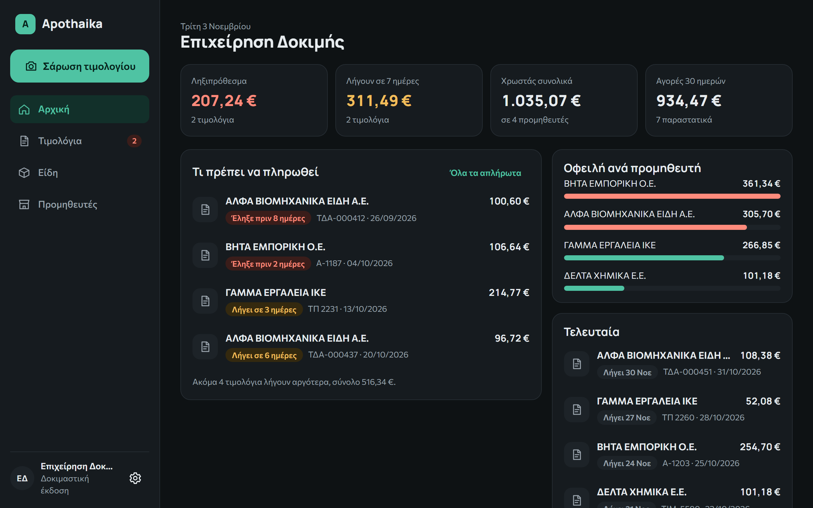
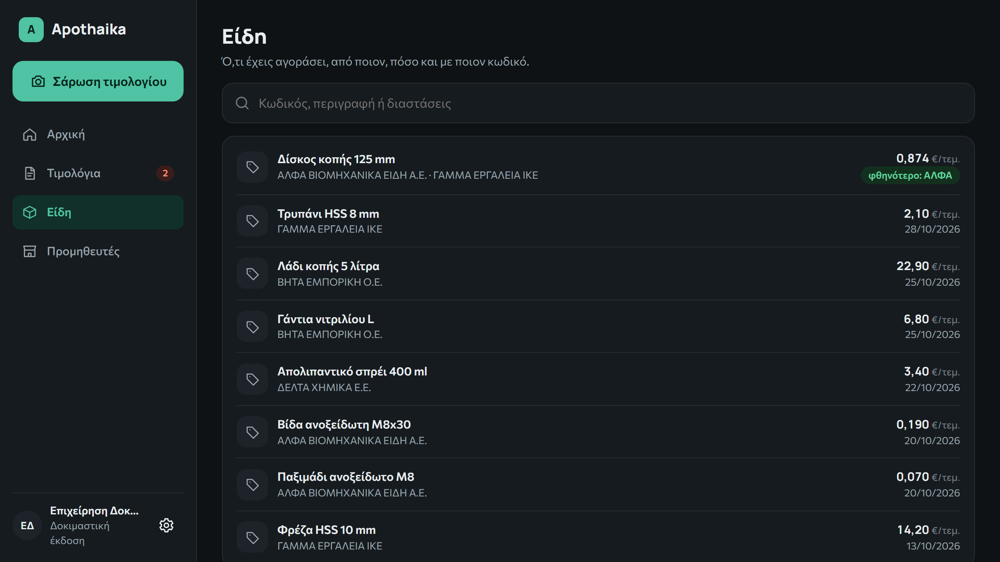
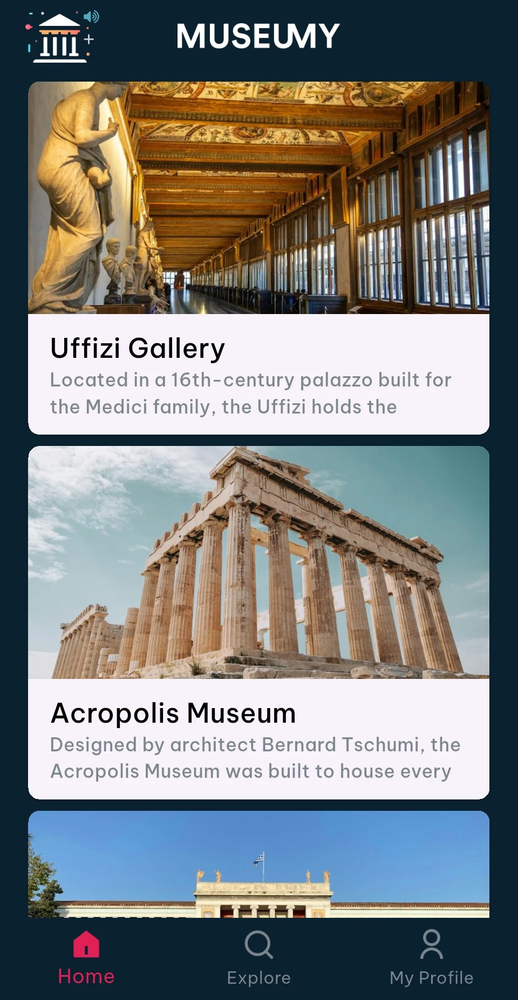
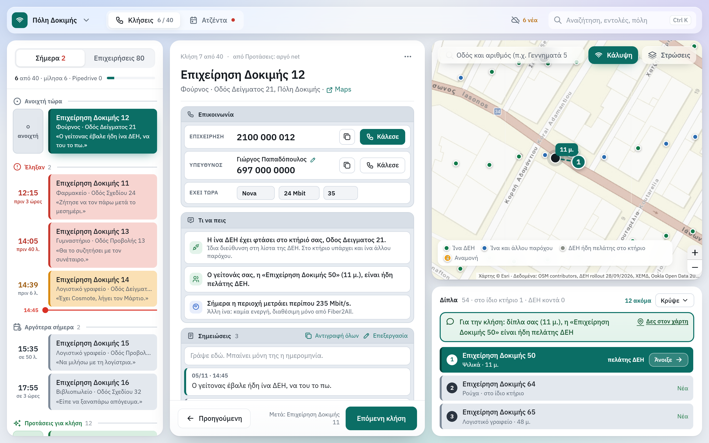
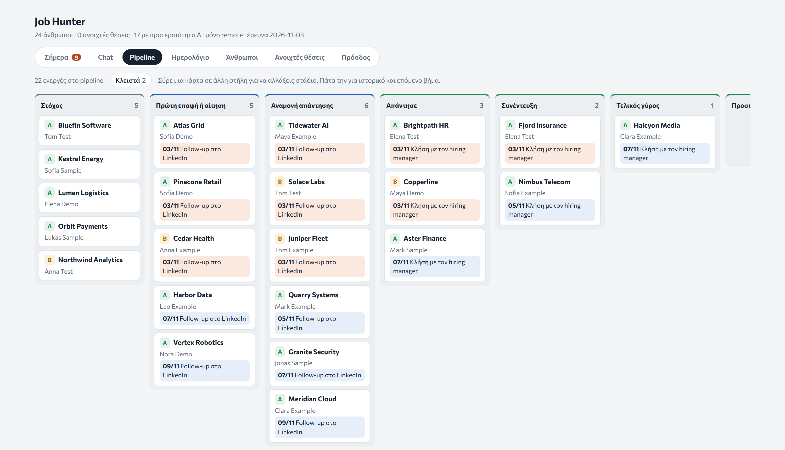
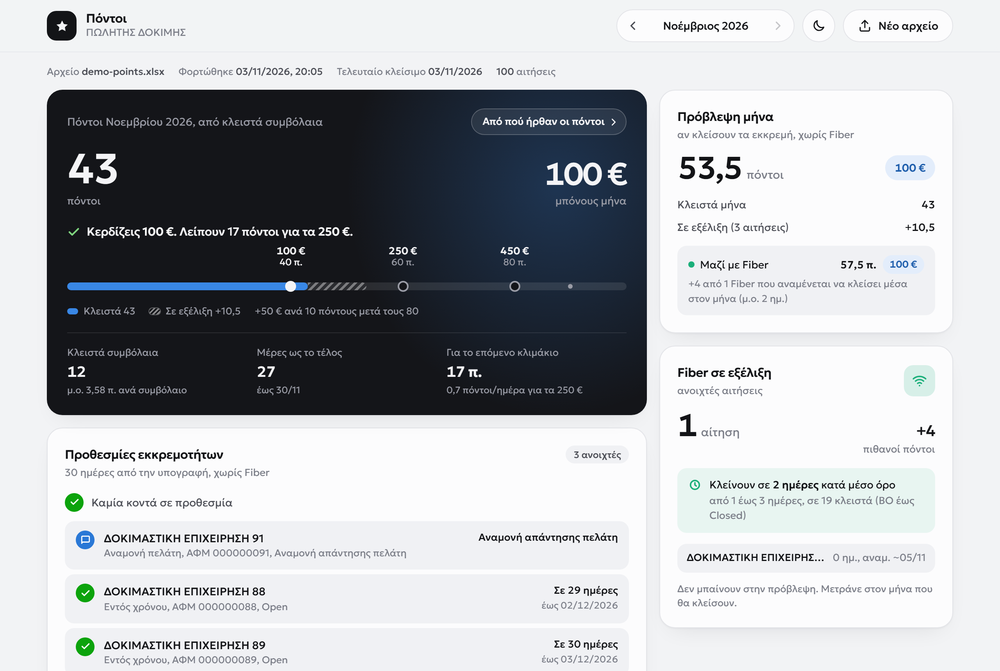

# Ioannis Argyras

B2B sales, builder, co-founder.

I sell to businesses and build products with AI. With a partner from the sport I co-founded Equicade, a B2B marketplace for show-jumping horses. Apothaika, my invoice app, is in closed beta with three businesses, and Museumy, my audio-guide app, already has an exhibition partner in Athens. At work I built the prospecting map that became the sales team's only source of customers and took our fiber contracts from 10–15 to 50–60 a month. 3 years in B2B sales, 5x my target in the first year. BSc in Informatics Engineering.

Each project below has the problem, what I built and the result. No code and no customer data.

| Project | What it is | Result so far |
|---|---|---|
| [Equicade](#equicade) | B2B marketplace for show-jumping horses, co-founded | Pre-launch with a waitlist |
| [Apothaika](#apothaika) | Reads supplier invoices from one photo and files them | Closed beta, three businesses |
| [Museumy](#museumy) | Audio-guide app for museums | Deal with a major Athens exhibition group |
| [Prospecting map](#prospecting-map) | Shows a sales team which businesses to call | Fiber contracts from 10–15 to 50–60 a month |
| [Job Hunter](#job-hunter) | Job-search CRM with AI that knows what's next and who I spoke to | All organised: I know who I spoke to and when |
| [Sales points tracker](#sales-points-tracker) | Points and bonus from the back-office Excel | Used by the whole team |

Based in Thessaloniki, Greece. Contact: [LinkedIn](https://www.linkedin.com/in/ioannis-argyras/)

## Equicade

**What it is.** A B2B marketplace for trading show-jumping horses, with France as the first market. Buyers state what they are looking for, and brokers and farms answer. Buyers join free, and brokers and farms pay a subscription with no commission on sales. Conversations are translated automatically, so a buyer and a seller from different countries can talk directly.

**The problem.** This market runs on phone calls, WhatsApp and personal relationships. It is split by country and language, and it is hard to enter without already knowing people.

**My part.** I co-founded it in May 2026 with a partner from the sport. I work on the platform and its data structure with AI-assisted development, and I ran the market research in Greece and France that shaped the go-to-market plan.

**Status.** Pre-launch, with a waitlist.

Public site: [equicade.com](https://equicade.com)

## Apothaika

**What it is.** A web app for small businesses in Greece. You take one photo of a purchase invoice, and AI reads everything on it, from the supplier and VAT number to every line item, and saves it to the database. You confirm it once, and from then on what you owe, to whom, by when and at what price is organised without typing anything in.

**The problem.** A small business with many suppliers needs to know what is unpaid, what is due and how prices have moved. Reading an invoice is becoming a commodity as Greek invoicing goes digital, so the value is in organising that information, and in handling what still arrives on paper.

**What I built.**

- One photo is enough: AI reads every field and line item, while you keep using the app
- Automatic checks on quantity times price, totals, VAT number and duplicate entries
- A memory of each supplier, which improves later readings
- A review screen: only what the user confirms is saved
- Separate data for each business, with an automated test that one business cannot see another

**Result so far.** A closed beta is running with three businesses. Before it started, on a test set of four invoices, correct fields went from 80–87% to 100%, and most readings dropped from 100–220 seconds to 11–40 seconds.

*Demo data: the businesses, invoices and figures are made up.*

**Status.** Closed beta with three businesses, by invitation only. No paying customers yet.

Site for the beta: [apothaika.gr](https://apothaika.gr)

**Next.** AI reading of sales and purchase trends, and a full management system (ERP) built around the invoice data.

**How I worked.** I built it with AI-assisted development. I wrote the requirements, compared AI models and prompts on real samples, and checked each result by hand.

## Museumy

**What it is.** A mobile app with audio guides for museums. A visitor finds museums on a map, opens a museum's page and listens to its tour, track by track.

**The problem.** Many small museums in Greece have no audio guide at all, and the ones that exist are often tied to one museum's own app or to rental devices.

**My part.** I built the app and the back end behind it, and I will run the sales.

**Result so far.** A working Android app, with a back end and an admin panel for the content. After seeing the alpha, a group that runs large exhibitions in Athens agreed to work with us. We are now building towards its exhibition in spring 2027, where we aim to be a strategic partner. Before building, I researched the Greek market: who already offers audio guides, how competitors charge, and which museums have none.

## Prospecting map

**What it is.** A desktop map for a fiber sales team. It shows which businesses to call: those with slow internet and no competing fiber in the building.

**The problem.** Our team of three had no reliable way to decide which businesses to call, and closed 10–15 fiber contracts a month.

**What I built.** I first made a simple coverage heat map for a colleague, then turned it into a working tool. It combines four sources:

- the company's own fiber coverage list
- the government registry of provider networks, which shows copper or fiber
- Ookla open speed data
- Google Places, for the businesses themselves

A rep opens a business and sees whether fiber is available, whether another provider already has fiber in the building, and the measured speed in the area. The rep then logs the outcome of the call, sets a callback and records when the current contract ends, so the next call happens on time.

**Result.** The team uses it every day as its only source of prospects. After the map and a new sales process went in, the team's fiber contracts rose from 10–15 to 50–60 a month.

**What came with it.** I rebuilt the sales process around the map: one script from first call to close, a Pipedrive pipeline with automations, customers assigned to reps by region, and training for new reps.

**How I worked.** I built it with AI-assisted development. I decided what the map had to answer, tested it on my own calls and changed it from daily use. Each new coverage file goes through a check for suspicious address numbers before the maps are rebuilt.

*Demo data: the streets, buildings, businesses and coverage are made up. The real map holds customer and company data.*

## Job Hunter

**What it is.** The CRM I built for my own job search, in the style of Pipedrive, with AI inside it. The AI reads every company file, so at any moment it knows what is due, who I spoke to, what was said and what I still have to do. It runs in the browser, on desktop and on phone.

**The problem.** Research, messages and follow-ups lived in a spreadsheet and an inbox. A list does not tell you who is waiting for a reply today, or what you already said to them.

**What I built.**

- A pipeline with drag-and-drop stages, from first contact to signature
- A calendar and a daily list of what is due
- Reminders set by rule: three days after a connection request, six days after an email or message
- One file per company, with the research, every message word for word and the replies
- A chat inside the app that reads those files and can search the web, so I can look something up from my phone

*Demo data: the companies and people are made up.*

**Result.** In daily use since October 2026, on laptop and phone. The whole search runs from it: the research on each company, every message word for word, the replies, and the next step with its date. Nothing lives in a spreadsheet or an inbox any more.

**How I worked.** I built it with AI-assisted development and changed it as I used it.

## Sales points tracker

**What it is.** A browser tool that reads a back-office Excel file, recalculates a sales rep's points and shows the bonus for the month.

**The problem.** A rep's points sit in a large Excel file, so it is hard to see during the month where you stand and how far the next bonus tier is. Each rep kept their own spreadsheet or counted on paper, and the counts did not always match.

**What I built.** You load the file and the tool shows your points for the month, where they came from, your current bonus and what you need per day to reach the next tier. The file is read in the browser.

**Result.** The whole team uses it instead of their own spreadsheets or paper. Everyone works from the same count, so there is no more disagreement over how many contracts a rep has.

*Demo data: the customers, points and bonus tiers are made up.*

**How I worked.** I built it with AI-assisted development, using the rules of the bonus scheme and checking the totals against past months.
