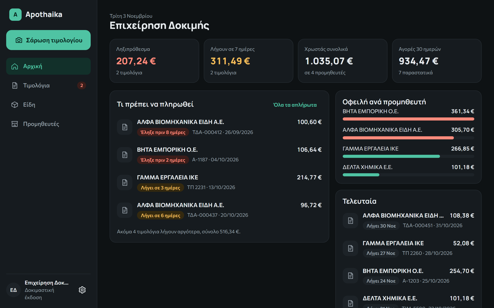
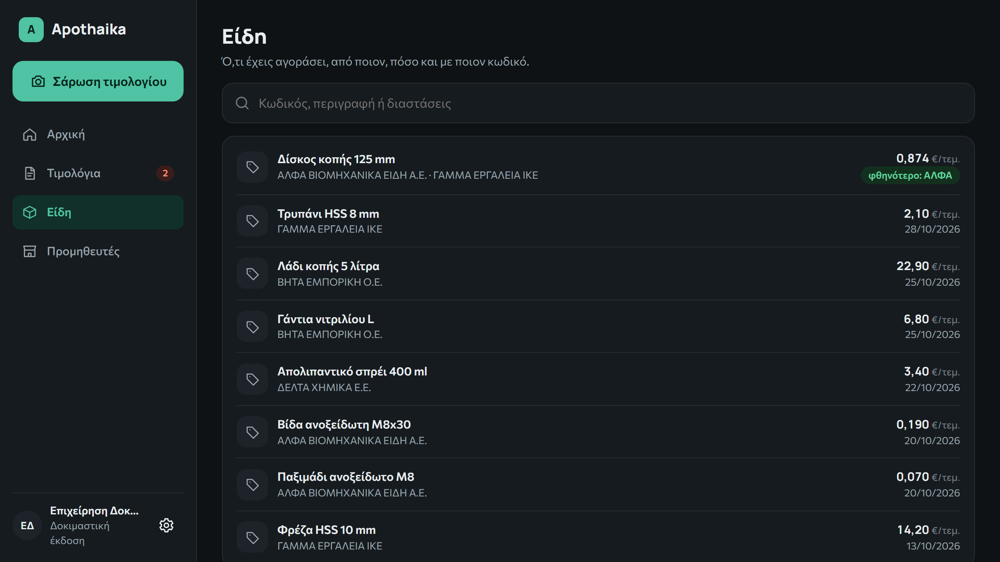

# Apothaika

[Back to all projects](../README.md)

**What it is.** A web app for small businesses in Greece. You take one photo of a purchase invoice, and AI reads everything on it, from the supplier and VAT number to every line item, and saves it to the database. You confirm it once, and from then on what you owe, to whom, by when and at what price is organised without typing anything in.

**The problem.** A small business with many suppliers needs to know what is unpaid, what is due and how prices have moved. Reading an invoice is becoming a commodity as Greek invoicing goes digital, so the value is in organising that information, and in handling what still arrives on paper.

**What I built.**

- One photo is enough: AI reads every field and line item, while you keep using the app
- Automatic checks on quantity times price, totals, VAT number and duplicate entries
- A memory of each supplier, which improves later readings
- A review screen: only what the user confirms is saved
- Separate data for each business, with an automated test that one business cannot see another

**Result so far.** A closed beta is running with three businesses. Before it started, on a test set of four invoices, correct fields went from 80–87% to 100%, and most readings dropped from 100–220 seconds to 11–40 seconds.

*Demo data: the businesses, invoices and figures are made up.*

**Status.** Closed beta with three businesses, by invitation only. No paying customers yet.

Site for the beta: [apothaika.gr](https://apothaika.gr)

**Next.** AI reading of sales and purchase trends, and a full management system (ERP) built around the invoice data.

**How I worked.** I built it with AI-assisted development. I wrote the requirements, compared AI models and prompts on real samples, and checked each result by hand.
