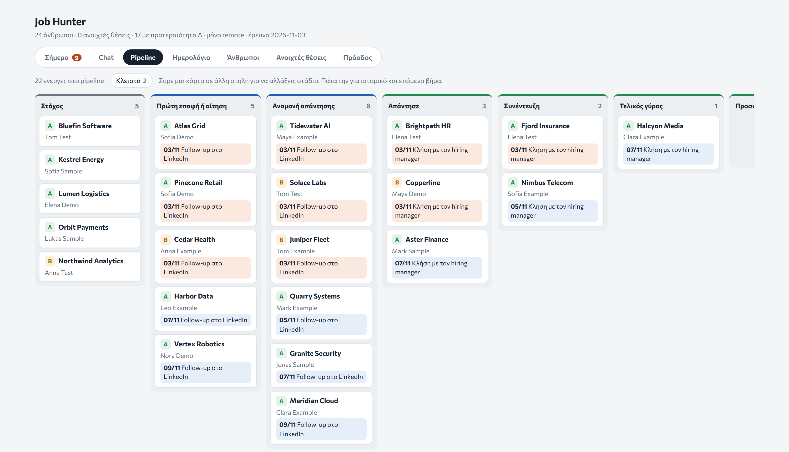

# Job Hunter

[Back to all projects](../README.md)

**What it is.** The CRM I built for my own job search, in the style of Pipedrive, with AI inside it. The AI reads every company file, so at any moment it knows what is due, who I spoke to, what was said and what I still have to do. It runs in the browser, on desktop and on phone.

**The problem.** Research, messages and follow-ups lived in a spreadsheet and an inbox. A list does not tell you who is waiting for a reply today, or what you already said to them.

**What I built.**

- A pipeline with drag-and-drop stages, from first contact to signature
- A calendar and a daily list of what is due
- Reminders set by rule: three days after a connection request, six days after an email or message
- One file per company, with the research, every message word for word and the replies
- A chat inside the app that reads those files and can search the web, so I can look something up from my phone

*Demo data: the companies and people are made up.*

**Result.** In daily use since October 2026, on laptop and phone. The whole search runs from it: the research on each company, every message word for word, the replies, and the next step with its date. Nothing lives in a spreadsheet or an inbox any more.

**How I worked.** I built it with AI-assisted development and changed it as I used it.
