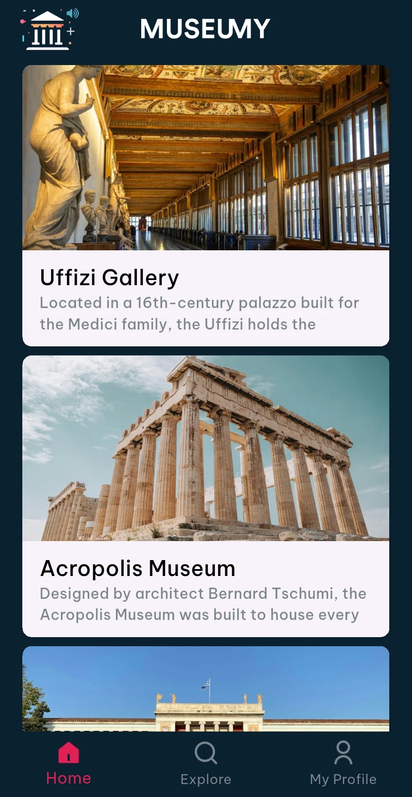

# Museumy

[Back to all projects](../README.md)

**What it is.** A mobile app with audio guides for museums. A visitor finds museums on a map, opens a museum's page and listens to its tour, track by track.

**The problem.** Many small museums in Greece have no audio guide at all, and the ones that exist are often tied to one museum's own app or to rental devices.

**My part.** I built the app and the back end behind it, and I will run the sales.

**Result so far.** A working Android app, with a back end and an admin panel for the content. After seeing the alpha, a group that runs large exhibitions in Athens agreed to work with us. We are now building towards its exhibition in spring 2027, where we aim to be a strategic partner. Before building, I researched the Greek market: who already offers audio guides, how competitors charge, and which museums have none.

