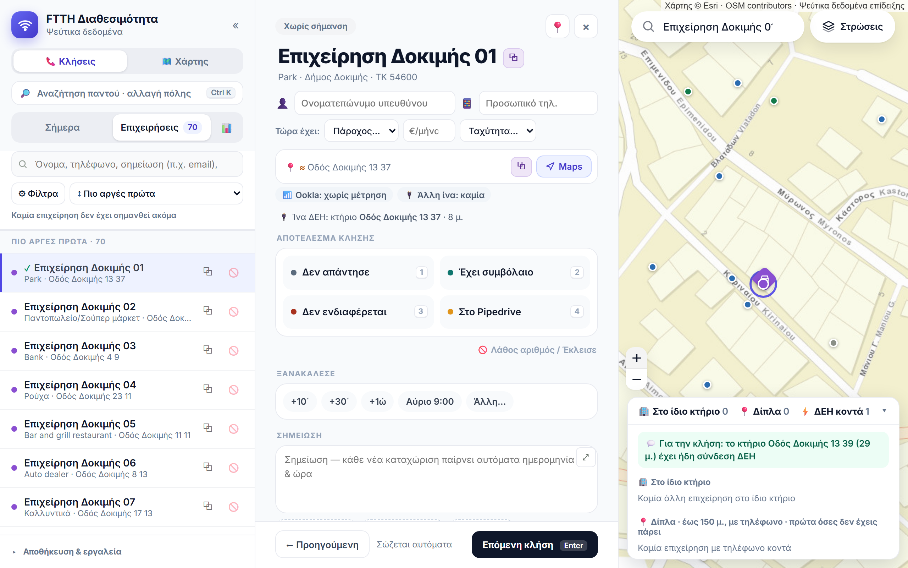

# Prospecting map

[Back to all projects](../README.md)

**What it is.** A desktop map for a fiber sales team. It shows which businesses to call: those with slow internet and no competing fiber in the building.

**The problem.** Our team of three had no reliable way to decide which businesses to call, and closed 10–15 fiber contracts a month.

**What I built.** I first made a simple coverage heat map for a colleague, then turned it into a working tool. It combines four sources:

- the company's own fiber coverage list
- the government registry of provider networks, which shows copper or fiber
- Ookla open speed data
- Google Places, for the businesses themselves

A rep opens a business and sees whether fiber is available, whether another provider already has fiber in the building, and the measured speed in the area. The rep then logs the outcome of the call, sets a callback and records when the current contract ends, so the next call happens on time.

**Result.** The team uses it every day as its only source of prospects. After the map and a new sales process went in, the team's fiber contracts rose from 10–15 to 50–60 a month.

**What came with it.** I rebuilt the sales process around the map: one script from first call to close, a Pipedrive pipeline with automations, customers assigned to reps by region, and training for new reps.

**How I worked.** I built it with AI-assisted development. I decided what the map had to answer, tested it on my own calls and changed it from daily use. Each new coverage file goes through a check for suspicious address numbers before the maps are rebuilt.

*Demo data: the streets, buildings, businesses and coverage are made up. The real map holds customer and company data.*
