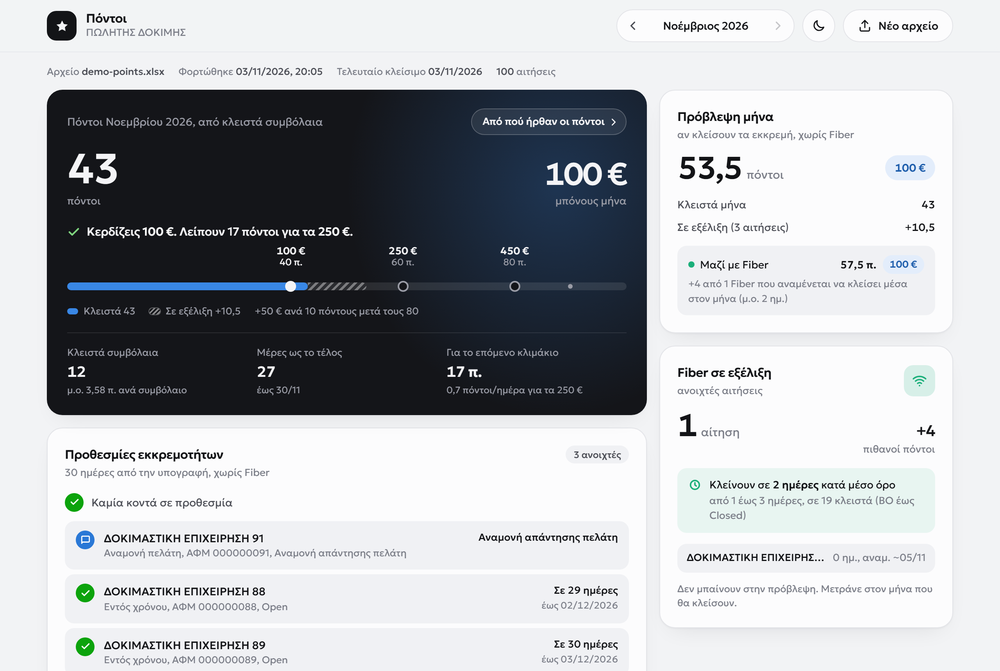

# Sales points tracker

[Back to all projects](../README.md)

**What it is.** A browser tool that reads a back-office Excel file, recalculates a sales rep's points and shows the bonus for the month.

**The problem.** A rep's points sit in a large Excel file, so it is hard to see during the month where you stand and how far the next bonus tier is. Each rep kept their own spreadsheet or counted on paper, and the counts did not always match.

**What I built.** You load the file and the tool shows your points for the month, where they came from, your current bonus and what you need per day to reach the next tier. The file is read in the browser.

**Result.** The whole team uses it instead of their own spreadsheets or paper. Everyone works from the same count, so there is no more disagreement over how many contracts a rep has.

*Demo data: the customers, points and bonus tiers are made up.*

**How I worked.** I built it with AI-assisted development, using the rules of the bonus scheme and checking the totals against past months.
